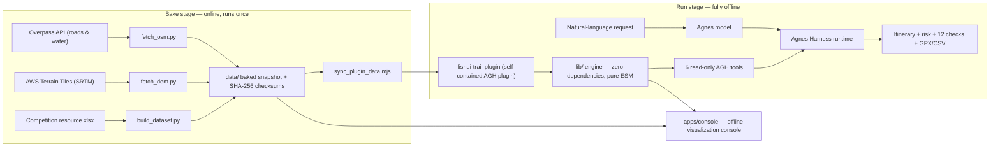

# Poetic Lishui · Riverside Slow Town — Suburban Tourism Route Intelligent Planning System

English | [简体中文](README.zh-CN.md)

**Entry of the 2026 Jiangsu Province AI + Science & Engineering Innovation Practice Hackathon (Undergraduate Division) — Team Green Dragon (绿龙)， No. U422.**

An **offline, local-first system** built on **AgnesHarness (AGH)** as the agent runtime and execution foundation: a curated tourism-resource dataset plus terrain / road-network / water layers are wrapped into a set of Agent-callable tools, delivering **personalized tourism route planning**, **multi-factor risk forecasting**, and results that are **reproducible and self-verifying**.

<p align="center">
  
</p>
<p align="center"><sub>Basemap rendered in real time from the baked DEM (hillshade + elevation-tint), with OSM water and road overlays.</sub></p>

---

## Contents

- [Project Overview](#project-overview)
- [Demo Video](#demo-video)
- [Quick Start](#quick-start)
- [Architecture](#architecture)
- [Integration Standards](#integration-standards)
- [Verification](#verification)
- [Repository Layout](#repository-layout)
- [License & Data Sources](#license--data-sources)

---

## Project Overview

### Background

Lishui is a water-town and low-hill district south of Nanjing. Its tourism resources are scattered across **8 towns and 162 resource anchors** (698 individual entities, 49 virtual objects, 58 water features). Existing navigation apps can only answer "point-to-point shortest path" — they cannot answer what a real traveler actually asks:

- I have 4 hours, average fitness, and kids with me. Which spots are feasible? Which deserve a deep visit and which are drive-by only?
- Does this route cross reservoirs or steep slopes? Can we finish before sunset? How far is the nearest rescue point?
- Change the interest profile (photography / intangible heritage / red-tourism) and the answer should change completely — yet stay **reproducible and explainable**.

The project models this as a **time-budgeted Orienteering Problem (OP)**, overlaid with **DEM + OSM constrained least-cost paths** and a **seven-factor weighted risk model**, and exposes the whole capability set as an **AGH plugin** that an agent can call.

### Core Features

| Capability | What you get |
| --- | --- |
| Personalized itinerary planning | Timeline itinerary with dwell times, distance / ascent / slope metrics, deep-vs-quick visit pacing, loop or one-way, must-visit / avoid / custom start constraints |
| Multi-factor risk forecasting | 7-factor weighted score (terrain & slope, weather & season, daylight & timing, water & slipperiness, remoteness & rescue, accessibility, fitness match) with key evidence and tiered mitigations |
| Result self-verification | 12 independent checks recomputed outside the solver, run on every plan call; reproducibility verified by re-solving with the same seed and comparing geometry hashes |
| Failure semantics | Infeasible requests return structured `reason` (3 distinguishable classes) + actionable `hint`, never a silently degraded plan |
| Anomaly handling | When a stop becomes unavailable, suggests similar alternatives by interest similarity + distance |
| Export | GPX 1.1 track (importable into TwoSteps / Strava / Garmin) and itinerary CSV |
| Offline visualization console | Zero-dependency local web console (also deployed online) that reuses the **same solver modules** as the AGH plugin |

### Innovation Highlights

1. **Agent-first architecture.** All computation is encapsulated as 6 read-only AGH backend tools (`ctx.extension().registerTool()`). The Agnes model only translates natural language into tool parameters and turns structured results into narrative — the system itself makes **zero model calls**, which satisfies the "Agnes models only" competition constraint by construction.
2. **Fully offline & deterministic.** Data is baked once into a self-contained snapshot (`tools/` scripts are the only online step; the plugin itself makes zero network requests). All stochastic processes use `mulberry32(seed)`; the same input + seed reproduces the route point-for-point, and reproducibility is enforced as verification check #12 on **every** call.
3. **A digital twin at honest resolution.** DEM is baked to a **30 m equal-area-square grid (2149 × 1511, int16)** — the true information limit of SRTM 1″ — with QC artifact repair (3,197 flagged cells, 0.0985%). Segment paths use raster A\* with the **Tobler hiking function**, slope caps, water-exclusion (bridges/embankments may cross), and road-network bias.
4. **Verifiable failure, not graceful lies.** Budget repairs happen with **real A\* geometry back-substitution** (fast estimate first, then downgrade/remove by worst benefit-per-minute and greedily re-fill), so the final plan **never exceeds budget in real geometry**. Must-visit points are hard constraints: the system computes their true cost and reports budget overruns honestly instead of silently dropping them.
5. **Everything is evidence.** 7 regression test suites ship with the repo, real AGH session logs (NDJSON + HTML) are archived under `docs/evidence/`, and every tool output carries a `provenance` block (source, SHA-256, CRS, counts, bbox).

---

## Demo Video

**Demo video (3 min 16 s, published 2026-10-15):** <https://www.bilibili.com/video/BV19jpm6jEaQ/> · short link <https://b23.tv/T5YePhy>

- Platform: Bilibili, title "绿龙队演示视频" (Team Green Dragon Demo Video).
- Publicly accessible — judges need **no login and no competitor account** to play it.
- The recording shows the AGH session with tool-call records expanded (tool name + parameters + structured results), which is the most direct evidence that the work runs on AGH.

<p align="center">
  
</p>

**Try it live (no login):** <https://lishui-tour-planner.app.workbuddy.host/>
The online console is the published version of the offline demo console. It performs **no model calls** — planning / risk / verification reuse the exact same solver modules as the AGH plugin, so every number shown on the page can be **byte-for-byte reproduced** by the `lishui_trail_*` tools in an AGH session with identical inputs.

**Run locally:** double-click `start.cmd` in the repository root, or `node apps/console/server.mjs --open` → <http://127.0.0.1:8763>.

---

## Quick Start

### Environment

| Requirement | Notes |
| --- | --- |
| Runtime | **Node.js ≥ 20** for the console, tests and plugin engine; **≥ 24.10** only if you install the plugin into a real AGH runtime (its native helper ABI requires it) |
| OS | Windows / macOS / Linux. `start.cmd` is a Windows convenience launcher; on other systems run the `node …` commands below |
| Network | **Not required at run time.** All data (DEM / OSM / POIs) is baked into the repository; only the optional re-bake scripts in `tools/` touch the network |
| Model / API keys | **None.** The console, the 7 test suites and the solver make **zero model calls** and need no API key. The Agnes model is only used inside an AGH session and is configured via AGH's own provider settings — credentials never enter this repository |
| Dependencies | **Zero third-party runtime dependencies** — no `npm install`, no build step |

### Run

```bash
# 1) Offline visualization console — the fastest way to see it work
node apps/console/server.mjs --open          # → http://127.0.0.1:8763
#    Windows alternative: double-click start.cmd

# 2) Verify without any model (~30 s, no network)
node tests/smoke.mjs                         # end-to-end plan + risk + 12 checks; exits 1 on any failure
node tests/plugin_check.mjs                  # loads the plugin and really executes all 6 tools
node tests/case_matrix.mjs                   # 15 normal / boundary / failure cases

# 3) Full agent loop inside AGH (Agnes model drives the tools)
#    Install → trust → enable the plugin, then talk to the model in a session.
#    Exact commands: see "Integration Standards §3" above and docs/AGH接入说明.md (Chinese).

# 4) Optional: re-bake the data snapshot (online; needs the organizer's original xlsx)
python tools/build_dataset.py && python tools/fetch_dem.py && python tools/fetch_osm.py
node tools/sync_plugin_data.mjs
```

---

## Architecture



### Layered design

| Layer | Content |
| --- | --- |
| **Data bake** (Python, online only here) | `tools/build_dataset.py` (xlsx → `pois.json`, rule-driven interest tagging), `tools/fetch_dem.py` (AWS Terrain Tiles → 30 m grid with cross-validation & QC), `tools/fetch_osm.py` (Overpass chunked fetch: 2,523 road segments + 839 water features) |
| **Baked snapshot** | `data/` — pois / water / DEM (int16 LE, row-major north→south, noData −32768) / OSM / `checksums.json`; synced into the plugin so it installs as a self-contained snapshot |
| **Engine** (`packages/lishui-trail-plugin/lib/`, zero-dependency ESM) | `geo` spherical geometry · `sun` NOAA sunrise/sunset · `climate` Nanjing 1991–2020 climate normals · `terrain` DEM/slope/Tobler/A\*/water & road grids · `dataset` loading & query · `profile` persona normalization · `planner` OP solving · `risk` 7-factor model · `verify` 12 checks · `gpx` GPX/CSV export · `envelope` ToolResult normalization · `engine` orchestration |
| **AGH plugin** (`index.mjs`) | Registers 6 tools on the AGH extension row; all declared `isReadOnly / replay:'safe' / requiresApproval:'never'` |
| **Model** | Agnes model (e.g. `agnes-3.0-flash`) inside AGH: NL → tool parameters, structured results → narrative. No other vendor model is ever contacted |
| **View** (`apps/console/`) | Zero-dependency Node HTTP server + single-page frontend (hand-written PNG encoder for the basemap, no CDN, no external assets) |

### Core algorithms

**Macro route solving — Orienteering Problem.** Nodes carry benefit (interest match + grade + richness + rarity + seasonal discount); edges carry time. Objective = benefit − over-budget penalty − depth-shortfall penalty − light time cost. Solver: greedy insertion → 2-opt / Or-opt local search → simulated annealing with multiple restarts (`mulberry32` seeded). Visit-depth preference (`deep / balanced / wide`) assigns each stop a deep-visit or quick-stop dwell time and benefit weight, with a constraint on the minimum number of deep stops.

**Micro segment paths — raster A\*.** Cost = Tobler walking time × slope penalty × road-network bias × water penalty. Terrain constraints: slopes above the cap are impassable; areal water bodies (lakes/reservoirs) are impassable **except along existing roads (bridges, embankments, culverts)**; linear channels are soft obstacles (costed, bridges preferred); leaving an existing trail carries a penalty. All tolerances are expressed **in meters** and converted to cells internally (`cellsFor()`), so constraint semantics do not drift when DEM resolution changes. When no path exists the search relaxes stepwise (widen domain → allow wading → relax slope) and **labels the degradation reason** — never a silent straight line.

**Budget repair with real geometry.** Solve with fast estimates first, then re-validate each leg with the real A\* geometry; if over budget, downgrade/remove the worst benefit-per-minute stops and greedily re-fill with high-value stops that actually fit in real geometry.

**Risk forecasting.** Seven weighted factors whose weights adapt to party composition / season / visit depth; outputs key evidence (max slope, steep-share, nearest water distance, farthest distance from a trail, expected finish vs. sunset margin) and tiered mitigations.

**Self-verification.** 12 checks recomputed **independently of the solver** (Haversine distance re-check, per-leg statistics re-check, cumulative ascent, time budget, slope constraints, must-visit coverage, avoid constraints, stop resolvability, risk threshold, **reproducibility — same-seed geometry hash**, geometry degeneracy, coordinate validity). Tolerances use *relative-or-absolute, whichever is wider*: distance 1% / 1 m, ascent 2% / 2 m. In the AGH tool path, the reproducibility check **re-solves the plan every call** and compares geometry hashes (~1.2 s → ~2.5 s, still seconds).

---

## Integration Standards

### 1. AGH plugin contract

The plugin is a standard AGH package (`packages/lishui-trail-plugin/package.json`):

```json
{
  "name": "lishui-trail",
  "type": "module",
  "exports": "./index.mjs",
  "engines": { "node": ">=20" },
  "agnes": {
    "plugins": [
      { "export": "lishuiTrailPlugin", "id": "ext:lishui/trail", "inject": ["extension"] }
    ]
  }
}
```

- **Registration API:** `ctx.extension().registerTool({ name, description, parameters, meta, execute })` — the plugin never starts its own server or bypasses the host.
- **Parameter schemas** carry TypeBox `Kind` markers (`Symbol.for('TypeBox.Kind')`) with `additionalProperties: false`, keeping the package zero-import while remaining schema-valid for the host.
- **Tool metadata contract** — every tool declares:

```json
{ "isReadOnly": true, "isDestructive": false, "isConcurrencySafe": true,
  "isOpenWorld": false, "replay": "safe", "requiresApproval": "never" }
```

i.e. read-only, no network, no side effects, safely replayable, never requires approval.

- **ToolResult envelope (strict).** AGH Core validates every returned `ToolResult` (`isToolResult` / `isJsonValue`): numbers must be finite; objects must be plain prototypes; no circular references; top-level keys limited to `content / isError / details / terminate / structured / deferred`; **any `undefined` leaf rejects the whole tool call** (`E_ENVELOPE`). All 9 return paths of the 6 tools funnel through a single `reply(text, structured)` normalizer (`lib/envelope.mjs`) that drops `undefined`, demotes non-finite numbers to `null`, flattens non-plain objects and truncates cycles. This defect class (offline tests green, AGH call rejected) is guarded by `tests/envelope_check.mjs` — 6 tools × 29 parameter sets, 0 failures.

### 2. Tool interface specification (6 tools)

| Tool | Purpose | Key parameters |
| --- | --- | --- |
| `lishui_trail_status` | Offline data & terrain readiness | — |
| `lishui_trail_query` | Search resource points by dims / type / town / keyword / radius | `dims[], type, town, keyword, nearLon, nearLat, radiusM, limit` |
| `lishui_trail_plan` | **Core**: itinerary + risk + self-verification | `persona, interests, interestText, fitness, durationMin, date, startTime, visitDepth, loop, party, mustVisit, avoid, startLon, startLat, seed, format` |
| `lishui_trail_risk` | Standalone risk assessment | same profile parameters |
| `lishui_trail_alternatives` | Alternatives when a stop is unavailable | `poiId` (required), `k` |
| `lishui_trail_export` | GPX 1.1 track + itinerary CSV (content only; host writes files) | profile parameters + `format: gpx / csv / both` |

Profile semantics: `persona ∈ {family, photo, history, nature, slow, culture}` · `fitness ∈ {relaxed, normal, strong}` · `durationMin 60–720` · `visitDepth ∈ {deep, balanced, wide}` · interests are 10-dimension weights in 0–1 (`landscape, water, farming, red, village, religion, intangible, museum, resort, food`) · POI ids look like `LS-28`.

Successful responses are structured (`ok, headline, start, loop, metrics, itinerary, legs, risk, verification{12 checks}, solver, warnings, provenance`); infeasible ones return `ok:false` with a distinguishable `reason` — ① start point outside dataset coverage (with bbox, nearest POI and distance), ② must-visit points blocked by budget (named), ③ no meaningful itinerary within budget — plus an actionable `hint` and per-point `warnings`.

### 3. Installation & integration method

```bash
node packages/cli/dist/local/agnes.mjs package inspect file:./packages/lishui-trail-plugin
node packages/cli/dist/local/agnes.mjs install   file:./packages/lishui-trail-plugin
node packages/cli/dist/local/agnes.mjs package trust  lishui-trail <INTEGRITY> <CAPABILITY_HASH>
node packages/cli/dist/local/agnes.mjs package enable lishui-trail
node packages/cli/dist/local/agnes.mjs package status
```

- The `file:` protocol requires a **relative path** (with `--cwd`); absolute paths raise `ProtocolViolation`.
- `install` prints a preview (package id / version / integrity / capabilityHash / blockers); after confirming no blockers, `trust` uses the printed integrity (it changes on every package edit) — the `capabilityHash` stays stable while contributions stay unchanged.
- Installed packages run from an immutable runtime snapshot; updating requires `disable → remove → install → trust → enable`.
- Node.js ≥ 24.10 is required by AGH's native helper ABI (the plugin engine itself only needs ≥ 20).
- The full walkthrough (AGH_HOME setup, Agnes model configuration, non-interactive config, session export) is documented in [`docs/AGH接入说明.md`](docs/AGH接入说明.md) (Chinese).

### 4. Console HTTP API (view layer)

`apps/console/server.mjs` (Node built-in `http`, zero dependencies, binds `127.0.0.1` by default; `HOST=0.0.0.0 PORT=<port>` to expose):

| Route | Method | Description |
| --- | --- | --- |
| `/` | GET | Console page (single file, inline CSS/JS, no external links) |
| `/api/meta` | GET | Dataset status, projection parameters, persona/fitness presets |
| `/api/pois` | GET | 162 tourism anchors with dimension tags and entity summaries |
| `/api/basemap.png` | GET | Server-rendered offline basemap (DEM hillshade + water + roads; 2149×1511 @30 m source, ≈1.3 MB) |
| `/api/plan` | POST | Route planning (risk + 12 checks + same-seed re-solve); body = plugin profile |
| `/api/alternatives` | POST | Alternative-stop recommendation |
| `/api/export` | POST | GPX / itinerary CSV export |

### 5. Data & technical standards

| Item | Standard |
| --- | --- |
| Coordinate reference | CGCS2000 (EPSG:4490) / WGS84-compatible approximation |
| DEM encoding | int16 little-endian, row-major north→south, noData −32768, `gridMode: metric-30m-square`, bilinear resample, QC: 3×3-median repair for \|cell − median\| > 40 m |
| Vector data | © OpenStreetMap contributors, ODbL (roads, water) |
| Solar & climate | NOAA sunrise/sunset algorithms; Nanjing 1991–2020 climate normals |
| Export formats | GPX 1.1 (validated header, importable into TwoSteps / Strava / Garmin), UTF-8 CSV |
| Integrity & provenance | SHA-256 (`data/checksums.json`, `meta.sourceSha256` matches the original xlsx byte-for-byte); every tool output carries a `provenance` block |
| Determinism | `mulberry32(seed)`; reproducibility enforced by check #12 on every plan/export call |

---

## Verification

Seven test suites run **without any model or network** (`node tests/<suite>.mjs`); raw outputs are archived in [`docs/evidence/regression/`](docs/evidence/regression):

| Suite | Coverage |
| --- | --- |
| `smoke.mjs` | End-to-end plan + risk + verification; **hard assertion**: any failed check or check-count ≠ 12 exits 1 |
| `plugin_check.mjs` | Loads the plugin with a fake Cordis Context: schemas, metadata, real execution of all 6 tools, GPX/CSV validity, same-seed reproducibility |
| `envelope_check.mjs` | Replicates AGH Core's `isToolResult`/`isJsonValue` criteria; audits 6 tools × 29 parameter sets |
| `case_matrix.mjs` | 15 cases (5 normal / 6 boundary / 4 failure) |
| `depth_check.mjs` | deep / balanced / wide pacing contrast |
| `id_consistency.mjs` | Itinerary poiId → dataset → alternatives consistency (162 POIs, 0 duplicates) |
| `verify_consistency.mjs` | The verifier verifying itself: zero values must not false-fail; criteria must not be loosened into always-pass |

Reference result (`node tests/smoke.mjs`, 300-minute budget, slow-town leisure persona):

```
Start at Wuxiang Mountain Scenic Area; loop through 3 tourism stops; 12.9 km / 100 m ascent /
≈278 min (93% of the 300-min budget); overall risk 36/100 (low); pacing: balanced —
2 deep visits + 1 quick stop. Self-verification: 12 checks — 12 pass, 0 warn, 0 fail.
```

Real AGH session evidence: [`docs/evidence/`](docs/evidence) — 225 events, 5 business tool calls (`status → plan → risk → alternatives → export`, all first-call successes) plus 2 built-in host calls, 0 errors; every model field is `agnes-3.0-flash`.

---

## Repository Layout

```
lishui-trail/
├─ data/                        Baked snapshot (reproducible — see tools/)
│  ├─ pois.json                Tourism resource dataset (162 anchors / 698 entities / 49 virtual objects)
│  ├─ water.json               Water features (58)
│  ├─ dem.bin / dem.json       2149×1511 @30 m elevation grid (int16, bilinear to metric square grid)
│  ├─ osm.json                 2,523 road segments + 839 water features
│  └─ checksums.json           SHA-256 checksums
├─ tools/                       Offline data-bake scripts (Python; only online stage)
├─ packages/lishui-trail-plugin/   ★ AGH plugin package (installable unit, ships its data)
│  ├─ index.mjs                6 AGH tool registrations
│  └─ lib/                     Zero-dependency engine (pure ESM, 12 modules)
├─ apps/console/                Offline visualization console (view layer of the plugin)
├─ tests/                       7 verification suites (run without any model)
├─ docs/                        Competition documents, AGH integration guide, evidence & regression outputs
├─ reports/                     Bake reports (dataset / DEM / OSM)
└─ start.cmd                    Windows double-click launcher for the console
```

---

## License & Data Sources

- Code: MIT (this repository).

### Third-party components & data

| Component | Used for | License / attribution |
| --- | --- | --- |
| AgnesHarness (AGH) | Agent runtime & execution foundation | Built locally from its public source; follows the upstream `LICENSE` / `NOTICE` |
| OpenStreetMap road network & water | Trail / water grids | © OpenStreetMap contributors, ODbL |
| AWS Open Data Terrain Tiles (Mapzen terrarium, SRTM-derived) | Elevation raster | Public open data |
| Tourism resource table (Lishui–Bowang) | Tourism dataset source | Provided by the competition organizers; copyright remains with the original provider. **The original xlsx is not redistributed here** — only rule-derived data (`data/pois.json`) with its source SHA-256 recorded in `data/checksums.json` |

No other third-party code, models or assets are used.

### What is intentionally not published

The public repository omits competition-submission-only files that contain personal information (the signed originality declaration with the handwritten signature, the submission-form draft and material checklist with member names / school / grades) and the organizer-provided original xlsx (copyright). They remain in the submitted ZIP package; their presence is documented in the baked-data checksums, so reproducibility and provenance are unaffected.

---

**Team Green Dragon (绿龙) · No. U422 · Undergraduate Division** — Zhang Mingsheng (captain), Li Minglei, Zhang Minglei · Advisor: Zhu Zhizhou
