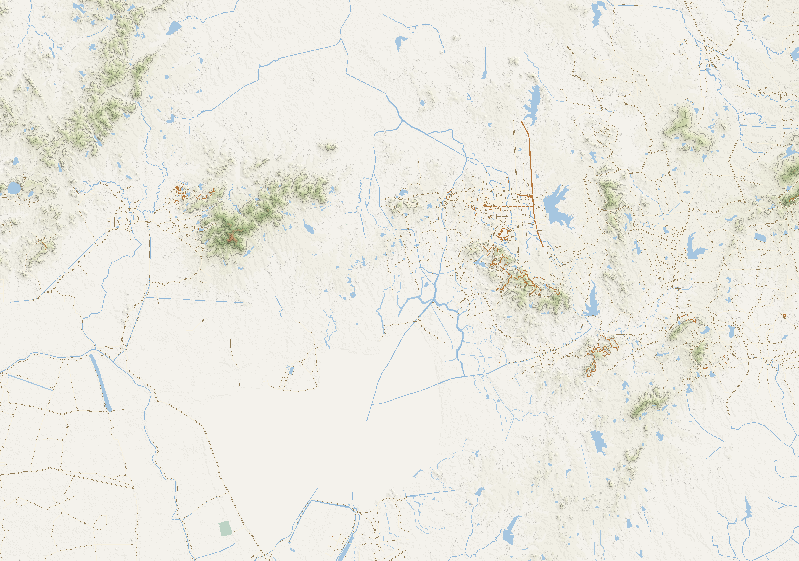
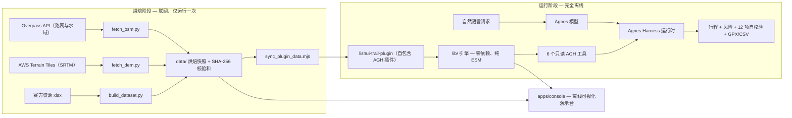

# 诗画溧水·水韵慢城——城郊文旅线路智能规划系统

[English](README.md) | 简体中文

**2026 年江苏省 AI+科学与工程创新实践黑客松（高校组）参赛作品 —— 绿龙队，参赛编号 U422。**

基于溧水地理空间数据的**离线本地系统**：由 **AgnesHarness（AGH）** 作为智能体运行与执行底座，把「文旅资源数据集 + 地形/路网/水域」连接成一组可被 Agent 调用的工具，实现**个性化旅游路线智能规划**与**多因子风险预判**，并给出可复现、可自校验的结果。

<p align="center">
  
</p>
<p align="center"><sub>演示台底图：由 DEM 实时渲染的山体晕渲 + 高程设色，叠加 OSM 水系/路网。</sub></p>

---

## 目录

- [项目介绍（Project Overview）](#项目介绍project-overview)
- [视频介绍（Demo Video）](#视频介绍demo-video)
- [快速开始（Quick Start）](#快速开始quick-start)
- [架构介绍（Architecture）](#架构介绍architecture)
- [集成标准（Integration Standards）](#集成标准integration-standards)
- [验证与证据](#验证与证据)
- [仓库结构](#仓库结构)
- [许可与数据来源](#许可与数据来源)

---

## 项目介绍（Project Overview）

### 项目背景

溧水是南京南部的水乡丘陵区，文旅资源分散在 **8 个街镇、162 个资源锚点**上（含 698 个资源单体、49 个虚拟对象、58 处水域要素）。现有导航软件只能做「点对点最短路径」，无法回答真实出游问题：

- 我只有 4 小时、体力一般、带着孩子，能走哪几处？哪几处值得深看、哪几处路过即可？
- 这条线会不会穿过水库/陡坡？日落前能不能走完？最近的救援点有多远？
- 换一个兴趣（摄影 / 非遗 / 红色人文）结果应该完全不同——但结果必须**可复现、可解释**。

本作品把上述问题建模为**带时间预算的定向越野问题（Orienteering Problem）**，叠加 **DEM + OSM 约束的最小代价路径**与**七因子加权风险模型**，并把整套能力以 **AGH 插件**的形式交给 Agent 调用。

### 核心功能

| 能力 | 说明 |
| --- | --- |
| 个性化路线规划 | 时间轴行程（含停留时长）、里程/爬升/坡度指标、深度游览与快速打卡的节奏控制、环线/单程、必去/避开/自定义起点约束 |
| 多因子风险预判 | 七因子加权评分（地形坡度、气象季节、日照时段、涉水湿滑、偏远救援、通行可达、体能匹配），输出关键证据与分级缓解建议 |
| 结果自校验 | 每次规划调用都执行 12 项独立自校验（独立于求解器重算）；可复现性以「同种子重解一次、比对几何哈希」的方式真实执行 |
| 失败语义 | 不可行请求返回结构化 `reason`（三类可区分）+ 可执行 `hint`，绝不静默退化为无意义方案 |
| 异常处置 | 某停靠点不可用时，按兴趣相似度 + 距离推荐同类替代点 |
| 导出 | GPX 1.1 轨迹（可导入两步路 / Strava / Garmin）与行程 CSV |
| 离线可视化演示台 | 零依赖本地 Web 控制台（另有在线版），复用与 AGH 插件**同一份**求解器模块 |

### 创新亮点

1. **Agent 优先的架构。** 全部计算封装为 6 个只读 AGH 后端工具（`ctx.extension().registerTool()`）；Agnes 模型只负责「把自然语言翻译成工具参数、把结构化结果讲成人话」——系统自身**零模型调用**，从而天然满足赛项「仅限 Agnes 模型」的约束。
2. **完全离线且确定性可复现。** 数据一次性烘焙为自包含快照（`tools/` 是唯一联网环节，插件运行零网络请求）；所有随机过程使用 `mulberry32(seed)`，同输入同种子结果逐点一致，且「可复现性」是**每次调用都真实执行**的第 12 项自校验。
3. **诚实分辨率下的数字孪生。** DEM 烘焙为 **30 m 等距方格网（2149 × 1511，int16）**——这是 SRTM 1″ 的高程真实信息上限，不假装更高精度；含伪影修复 QC（3,197 个标记格，0.0985%）。段间路径用栅格 A\* + **Tobler 步行速度函数**，带坡度禁行、水域禁行（桥/堤可跨越）、路网偏置。
4. **可验证的失败，而非体面的谎言。** 预算修复用**真实 A\* 几何回代**：先快速估计求解，再按「单位收益耗时」最差者降级/剔除、贪心回填真实几何下确实放得下的高价值点，最终方案**在真实几何下不超预算**。必去点是硬约束：系统算清其真实代价，如实报出超预算，而不是悄悄删点。
5. **一切皆证据。** 仓库随附 7 个回归测试套件；真实 AGH 会话日志（NDJSON + HTML）存档于 `docs/evidence/`；每个工具输出都带 `provenance` 溯源块（来源、SHA-256、CRS、计数、范围）。

---

## 视频介绍（Demo Video）

**演示视频（3 分 16 秒，2026-10-15 发布）**：<https://www.bilibili.com/video/BV19jpm6jEaQ/> · 短链 <https://b23.tv/T5YePhy>

- 平台：哔哩哔哩，标题「绿龙队演示视频」；
- 公开可访问，评委**无需登录、无需参赛者账号**即可播放；
- 录屏中展开了 AGH 会话的工具调用记录（工具名 + 参数 + 结构化返回），是「作品确实运行在 AGH 上」最直接的证据。

<p align="center">
  
</p>

**在线体验（免登录）**：<https://lishui-tour-planner.app.workbuddy.host/>
在线演示台是离线控制台的发布版，**不做任何模型调用**：规划/风险/自校验复用与 AGH 插件同一份求解器模块，页面上算出的每个结果都能被 AGH 会话中的 `lishui_trail_*` 工具以相同输入**逐字节复现**。

**本地运行**：双击仓库根目录的 `start.cmd`，或执行 `node apps/console/server.mjs --open` → <http://127.0.0.1:8763>。

---

## 快速开始（Quick Start）

### 环境配置

| 要求 | 说明 |
| --- | --- |
| 运行时 | 控制台 / 测试 / 插件引擎只需 **Node.js ≥ 20**；仅当要把插件装入真实 AGH 运行时时需要 **≥ 24.10**（其原生辅助程序 ABI 要求） |
| 操作系统 | Windows / macOS / Linux 均可。`start.cmd` 是 Windows 便捷启动器，其他系统直接用下面的 `node …` 命令 |
| 网络 | **运行阶段不需要联网**。DEM / OSM / 文旅数据全部烘焙进仓库；只有 `tools/` 下可选的重新烘焙脚本会联网 |
| 模型 / API Key | **都不需要**。控制台、7 套测试与求解器**零模型调用**、零 API Key；Agnes 模型只在 AGH 会话内使用，凭据由 AGH 自身配置管理，**不进本仓库** |
| 依赖 | **零第三方运行时依赖** —— 无需 `npm install`，无构建步骤 |

### 运行方法

```bash
# 1) 离线可视化演示台 —— 最快看到效果
node apps/console/server.mjs --open          # → http://127.0.0.1:8763
#    Windows 下也可直接双击 start.cmd

# 2) 无模型自检（约 30 秒，不联网）
node tests/smoke.mjs                         # 端到端规划 + 风险 + 12 项自校验，任一失败即退出码 1
node tests/plugin_check.mjs                  # 加载插件并真实执行全部 6 个工具
node tests/case_matrix.mjs                   # 正常 / 边界 / 失败 三类共 15 例

# 3) 在 AGH 中跑完整智能体闭环（Agnes 模型驱动工具）
#    安装 → trust → enable 插件后，在会话中让模型调用工具即可。
#    具体命令见上文「集成标准 §3」与 docs/AGH接入说明.md。

# 4) 可选：重新烘焙数据快照（需联网与赛方原始表格）
python tools/build_dataset.py && python tools/fetch_dem.py && python tools/fetch_osm.py
node tools/sync_plugin_data.mjs
```

---

## 架构介绍（Architecture）



### 分层设计

| 层 | 内容 |
| --- | --- |
| **数据烘焙**（Python，仅此环节联网） | `tools/build_dataset.py`（xlsx → `pois.json`，规则驱动兴趣维度标注）、`tools/fetch_dem.py`（AWS Terrain Tiles → 30 m 方格网 + 交叉校验与 QC）、`tools/fetch_osm.py`（Overpass 分块抓取：2,523 条路网 + 839 处水域） |
| **烘焙快照** | `data/` — pois / water / DEM（int16 小端，行主序北→南，noData −32768）/ OSM / `checksums.json`；同步进插件包，使插件作为自包含快照安装 |
| **引擎**（`packages/lishui-trail-plugin/lib/`，零依赖 ESM） | `geo` 球面几何 · `sun` NOAA 日出日落 · `climate` 南京 1991—2020 气候常年值 · `terrain` DEM/坡度/Tobler/A\*/水域与路网栅格 · `dataset` 数据加载与检索 · `profile` 画像归一化 · `planner` OP 求解 · `risk` 七因子模型 · `verify` 12 项自校验 · `gpx` GPX/CSV 导出 · `envelope` ToolResult 归一化 · `engine` 编排 |
| **AGH 插件**（`index.mjs`） | 在 AGH 扩展行注册 6 个工具；全部声明 `isReadOnly / replay:'safe' / requiresApproval:'never'` |
| **模型** | AGH 内配置的 Agnes 模型（如 `agnes-3.0-flash`）：自然语言 → 工具参数，结构化结果 → 中文说明；不接入任何其他厂商模型 |
| **视图**（`apps/console/`） | 零依赖 Node HTTP 服务 + 单页前端（底图用手写 PNG 编码器渲染，零外链、零 CDN） |

### 核心算法

**宏观路线求解——定向越野问题。** 节点收益 = 兴趣匹配 + 分级 + 资源丰富度 + 稀有度 + 季节折扣；边耗时。目标函数 = 收益 − 超预算罚 − 深度不足罚 − 轻微时间成本。求解：贪心插入 → 2-opt / Or-opt 局部搜索 → 模拟退火（多次重启，`mulberry32` 种子化）。游览深度偏好（`deep / balanced / wide`）为每站分配「深度游览 / 快速打卡」两种停留时长与收益折算，并约束「至少多少站必须深看」。

**微观段间路径——栅格 A\*。** 代价 = Tobler 步行时间 × 坡度惩罚 × 路网偏置 × 水域惩罚。地形约束：坡度超上限禁行；**面状水域（湖/库）禁行，但既有道路（桥、堤、涵）可跨越**；线状河道为软障碍（抬高代价，优先走桥）；离开既有步道有代价。所有判据以**米**表达、内部再换算成格数（`cellsFor()`），DEM 分辨率变化时约束语义不漂移。无解时逐级放宽（扩大搜索域 → 允许涉水 → 放宽坡度）并**标记降级原因**，不静默退化为直线。

**预算回代修复 + 真实几何回填。** 先用快速估计求解，再用真实 A\* 几何回代校验；超预算则按「单位收益耗时」最差者降级或剔除，再贪心回填真实几何下确实放得下的高价值点。

**风险预判。** 七因子加权，权重随同行人员/季节/游览深度自适应；输出关键证据（最大坡度、陡坡占比、最近水域距离、离步道最远距离、预计结束时刻与日落余量）与分级缓解建议。

**结果自校验。** 12 项检查**独立于求解器**重算（Haversine 重算距离、地形模块重算分段与坡度、累计爬升、时间预算、坡度约束、必去点覆盖、避开点约束、停靠点可解析、风险阈值、**可复现性——同种子几何哈希一致**、几何退化、坐标有效性）。一致性判据用**相对容差与绝对下限取较宽者**：里程 1% / 1 m，爬升 2% / 2 m。AGH 工具路径下「可复现性」**每次调用都重解一次**并比对几何哈希（约 1.2 s → 2.5 s，仍属秒级）。

---

## 集成标准（Integration Standards）

### 1. AGH 插件契约

插件是标准 AGH 包（`packages/lishui-trail-plugin/package.json`）：

```json
{
  "name": "lishui-trail",
  "type": "module",
  "exports": "./index.mjs",
  "engines": { "node": ">=20" },
  "agnes": {
    "plugins": [
      { "export": "lishuiTrailPlugin", "id": "ext:lishui/trail", "inject": ["extension"] }
    ]
  }
}
```

- **注册 API**：`ctx.extension().registerTool({ name, description, parameters, meta, execute })`——插件不自行起服务、不绕过 Host；
- **参数 Schema** 携带 TypeBox `Kind` 标记（`Symbol.for('TypeBox.Kind')`）且 `additionalProperties: false`，在保持零 import 的同时对宿主是合法 Schema；
- **工具元数据契约**——每个工具统一声明：

```json
{ "isReadOnly": true, "isDestructive": false, "isConcurrencySafe": true,
  "isOpenWorld": false, "replay": "safe", "requiresApproval": "never" }
```

即只读、不联网、无副作用、可安全重放、免审批。

- **ToolResult 信封（严格校验）**。AGH Core 对工作区工具返回的 `ToolResult` 做严格校验（`isToolResult` / `isJsonValue`）：数字必须有限；对象必须是纯对象原型；不允许环引用；顶层只允许 `content / isError / details / terminate / structured / deferred`；**任何 `undefined` 叶子都会让整次工具调用被拒**（`E_ENVELOPE`）。6 个工具的 9 处返回全部经由统一的 `reply(text, structured)` 归一化出口（`lib/envelope.mjs`）：递归丢弃 `undefined`、非有限数值降级为 `null`、非纯对象摊平、环引用截断。这一类「离线测试全绿、接进 AGH 却整次失败」的缺陷由 `tests/envelope_check.mjs` 守住——6 工具 × 29 组入参，失败 0 例。

### 2. 工具接口规范（6 个工具）

| 工具 | 作用 | 关键参数 |
| --- | --- | --- |
| `lishui_trail_status` | 离线数据与地形能力就绪状态 | — |
| `lishui_trail_query` | 按维度/类型/街镇/关键词/半径检索资源点 | `dims[], type, town, keyword, nearLon, nearLat, radiusM, limit` |
| `lishui_trail_plan` | **核心**：行程 + 风险 + 自校验 | `persona, interests, interestText, fitness, durationMin, date, startTime, visitDepth, loop, party, mustVisit, avoid, startLon, startLat, seed, format` |
| `lishui_trail_risk` | 独立风险评估入口 | 同画像参数 |
| `lishui_trail_alternatives` | 停靠点不可用时的替代建议 | `poiId`（必填）、`k` |
| `lishui_trail_export` | GPX 1.1 轨迹 + 行程 CSV（只回传内容，落盘交由宿主文件工具） | 画像参数 + `format: gpx / csv / both` |

画像语义：`persona ∈ {family, photo, history, nature, slow, culture}` · `fitness ∈ {relaxed, normal, strong}` · `durationMin 60–720` · `visitDepth ∈ {deep, balanced, wide}` · 兴趣为 10 维 0—1 权重（`landscape, water, farming, red, village, religion, intangible, museum, resort, food`）· 点位 ID 形如 `LS-28`。

可行时返回结构化结果（`ok, headline, start, loop, metrics, itinerary, legs, risk, verification{12 项}, solver, warnings, provenance`）；不可行时返回 `ok:false` 与可区分的 `reason`——① 起点落在数据集覆盖范围外（附范围、最近资源点与距离）；② 必去点被预算挡住（点名）；③ 预算内确实无法形成有意义行程——另附可执行的 `hint` 与逐点 `warnings`。

### 3. 安装与集成方式

```bash
node packages/cli/dist/local/agnes.mjs package inspect file:./packages/lishui-trail-plugin
node packages/cli/dist/local/agnes.mjs install   file:./packages/lishui-trail-plugin
node packages/cli/dist/local/agnes.mjs package trust  lishui-trail <INTEGRITY> <CAPABILITY_HASH>
node packages/cli/dist/local/agnes.mjs package enable lishui-trail
node packages/cli/dist/local/agnes.mjs package status
```

- `file:` 来源协议要求**相对路径**（配 `--cwd` 使用），绝对路径会报 `ProtocolViolation`；
- `install` 会打印 preview（包 ID / 版本 / integrity / capabilityHash / blockers）；确认无 blockers 后，用 preview 打印的 integrity 去 `trust`（**integrity 每次改包都会变**，`capabilityHash` 在贡献声明不变时保持稳定）；
- 已安装的包从不可变运行时快照运行；更新必须走 `disable → remove → install → trust → enable`；
- AGH 原生 helper 的 ABI 要求 Node.js ≥ 24.10（插件引擎本身只需 ≥ 20）；
- 完整接入流程（AGH_HOME 准备、Agnes 模型配置、非交互配置、会话导出）见 [`docs/AGH接入说明.md`](docs/AGH接入说明.md)。

### 4. 演示台 HTTP 接口（视图层）

`apps/console/server.mjs`（Node 内置 `http`，零依赖，默认仅监听 `127.0.0.1`；`HOST=0.0.0.0 PORT=<端口>` 可对外）：

| 路由 | 方法 | 说明 |
| --- | --- | --- |
| `/` | GET | 演示台页面（单文件，内联 CSS/JS，零外链） |
| `/api/meta` | GET | 数据集状态、投影参数、人群/体能预设 |
| `/api/pois` | GET | 162 个文旅锚点（含维度标签与单体摘要） |
| `/api/basemap.png` | GET | 服务端实时渲染的离线底图（DEM 晕渲 + 水域 + 路网；2149×1511 @30 m 源数据，约 1.3 MB） |
| `/api/plan` | POST | 路线规划（风险 + 12 项自校验 + 同种子复算）；入参即插件画像 |
| `/api/alternatives` | POST | 停靠点替代建议 |
| `/api/export` | POST | 导出 GPX / 行程 CSV |

### 5. 数据与技术标准

| 项目 | 标准 |
| --- | --- |
| 坐标系 | CGCS2000（EPSG:4490）/ WGS84 近似 |
| DEM 编码 | int16 小端，行主序北→南，noData −32768，`gridMode: metric-30m-square`，双线性重采样；QC：\|格值 − 3×3 中值\| > 40 m 时以中值修复 |
| 矢量数据 | © OpenStreetMap 贡献者，ODbL（路网、水域） |
| 日照与气候 | NOAA 日出日落算法；南京 1991—2020 气候常年值 |
| 导出格式 | GPX 1.1（校验头部合法，可导入两步路 / Strava / Garmin）、UTF-8 CSV |
| 完整性与溯源 | SHA-256（`data/checksums.json`；`meta.sourceSha256` 与原始 xlsx 逐字节一致）；每个工具输出带 `provenance` 溯源块 |
| 确定性 | `mulberry32(seed)`；可复现性作为第 12 项自校验在每次 plan/export 调用时真实执行 |

---

## 验证与证据

七个测试套件**无需模型、无需联网**即可运行（`node tests/<套件>.mjs`），原始输出存档于 [`docs/evidence/regression/`](docs/evidence/regression)：

| 套件 | 覆盖 |
| --- | --- |
| `smoke.mjs` | 端到端规划 + 风险 + 自校验；**硬断言**：任一失败项或检查项数 ≠ 12 即退出码 1 |
| `plugin_check.mjs` | 用假 Cordis Context 加载插件：Schema、元数据、6 工具真实执行、GPX/CSV 合法性、同种子复现性 |
| `envelope_check.mjs` | 复刻 AGH Core 的 `isToolResult`/`isJsonValue` 判据；审计 6 工具 × 29 组入参 |
| `case_matrix.mjs` | 15 例（正常 5 / 边界 6 / 失败 4） |
| `depth_check.mjs` | deep / balanced / wide 三档节奏对照 |
| `id_consistency.mjs` | 行程 poiId → 数据集 → 替代点建议三者一致（162 点位、0 重复） |
| `verify_consistency.mjs` | 自校验校验自身：零值不得误报失败；判据不得被放宽成「永远通过」 |

基准结果（`node tests/smoke.mjs`，300 分钟预算，慢城休闲画像）：

```
从「无想山景区」出发，环线串联 3 个文旅停靠点，步行 12.9 km / 累计爬升 100 m /
总耗时约 278 分钟（预算 300 分钟，占用 93%），综合风险 36/100（较低），
节奏均衡——深度游览 2 站 + 快速打卡 1 站。
自校验：12 项检查——通过 12，警告 0，失败 0。
```

真实 AGH 会话证据：[`docs/evidence/`](docs/evidence) —— 225 事件，本作品 5 次业务工具调用（`status → plan → risk → alternatives → export`，首次调用全部成功）另含宿主内置 2 次，0 错误；模型字段全为 `agnes-3.0-flash`。

---

## 仓库结构

```
lishui-trail/
├─ data/                        烘焙快照（可复现，见 tools/）
│  ├─ pois.json                文旅资源数据集（162 锚点 / 698 单体 / 49 虚拟对象）
│  ├─ water.json                水域要素（58）
│  ├─ dem.bin / dem.json        2149×1511 @30m 高程栅格（int16，双线性重采样到等距方格网）
│  ├─ osm.json                  2523 条路网 + 839 处水域
│  └─ checksums.json            SHA-256 校验和
├─ tools/                       离线数据烘焙脚本（Python，唯一联网环节）
├─ packages/lishui-trail-plugin/    ★ AGH 插件包（可安装单元，随包分发数据）
│  ├─ index.mjs                 6 个 AGH 工具注册
│  └─ lib/                      零依赖引擎（纯 ESM，12 个模块）
├─ apps/console/                离线可视化演示台（插件视图层）
├─ tests/                       7 个验证套件（无需模型即可运行）
├─ docs/                        参赛文档、AGH 接入说明、运行证据与回归输出
├─ reports/                     烘焙报告（数据集 / 高程 / OSM）
└─ start.cmd                    Windows 双击启动演示台
```

---

## 许可与数据来源

- 代码：MIT（本仓库）。

### 第三方组件与数据

| 组件 | 用途 | 许可证 / 来源 |
| --- | --- | --- |
| AgnesHarness（AGH） | 智能体运行与执行底座 | 使用其公开源码本地构建；遵循上游 `LICENSE` / `NOTICE` |
| OpenStreetMap 路网与水域 | 步道 / 水域栅格 | © OpenStreetMap 贡献者，ODbL |
| AWS Open Data Terrain Tiles（Mapzen terrarium，SRTM 派生） | 高程栅格 | 公开开放数据；烘焙为 30 m 等距方格网（2149×1511，int16），SRTM 1″ ≈ 30 m 为本区域高程的真实信息上限 |
| 溧水—博望文旅资源表 | 文旅数据集来源 | 赛方提供，版权归原提供方。**原始 xlsx 不在本仓库再分发**——仓库内只有按可复现规则派生的 `data/pois.json`，原始文件 SHA-256 记录于 `data/checksums.json` |

除此之外，作品中不含其他第三方代码、模型或素材。

### 有意不公开的内容

公开仓库有意省略仅用于赛事提交、且含个人信息的文件（含手写签名的独立完成声明、参赛信息填写稿与提交材料清单），以及版权归原提供方的赛方原始 xlsx。上述文件仍保留在提交 ZIP 中；烘焙数据的校验和已记录其存在，可复现性与溯源不受影响。

---

**绿龙队 · 参赛编号 U422 · 本科生组** —— 张明升（队长）、厉铭磊、张明磊 · 指导老师：朱治州
